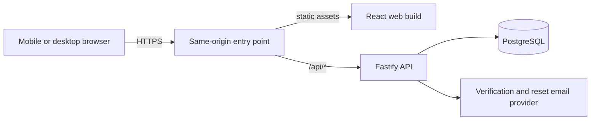

# Architecture and financial contract

This is a proposed design, not an installed or verified runtime.

## Stack and boundaries

Use TypeScript throughout, a pnpm workspace, a React/Vite SPA in `apps/web`,
a Fastify service in `apps/api`, and PostgreSQL with Drizzle migrations.
Vite fits an authenticated application with a separate API and no current SEO
requirement. Do not add a second server-side application layer solely for this
dashboard. pnpm handles workspace scripts initially; add a task cache only if
measured build times justify one.

Use Better Auth's Fastify integration for sessions and verified email/password
identity; implement household authorization in Kivo. Use TanStack Router for
navigation and TanStack Query for fetched state. A small typed fetch layer uses
shared DTOs; do not add a generated client until it removes demonstrated work.
Choose TypeBox/JSON Schema with Fastify's type provider for request and response
contracts. Reject invalid/extra financial fields; never accept membership or
ownership claims merely because TypeScript considers a request well typed.

Proposed structure; create files only as the matching slice needs them:

```text
kivo/
├── apps/
│   ├── web/src/
│   │   ├── app/                 # router, providers, shell
│   │   ├── components/ui/       # selected source-owned primitives and tokens
│   │   └── features/            # expenses, balances, goals, personal, budgets
│   └── api/
│       ├── src/
│       │   ├── app.ts           # injectable Fastify app, separate from listen
│       │   ├── auth/            # sessions, workspace access, invitation checks
│       │   ├── db/              # schema, queries, connection
│       │   └── features/        # feature routes and domain operations
│       └── migrations/
├── packages/
│   ├── contracts/src/           # public request/response schemas and DTOs
│   └── finance/src/             # pure cent allocation shared by preview/API
├── tests/e2e/                   # cross-application user journeys
├── skills/                     # repo-local instructions, linked by AGENTS.md
├── docs/
├── pnpm-workspace.yaml
└── package.json
```

Dependency direction: web → contracts/finance; API → contracts/finance and its
own database. Shared packages import neither app. Keep database code in the API
until another server application actually needs it. UI stays in web until a
second web consumer exists. Feature functions can call Drizzle directly; extract
a service only for a meaningful transaction or business rule, not every table.

Pin compatible stable Node/pnpm and package versions during scaffolding; commit
the lockfile. Use strict TypeScript, ESLint and Prettier, Vitest for small logic
tests, API injection plus PostgreSQL for integration, and Playwright for browser
journeys. Root scripts and CI arrive with slice 1; none exist yet.

## Runtime topology



Use secure, HttpOnly session cookies and explicit trusted origins. Verify CSRF
protection on Kivo mutation routes as well as the auth integration. Avoid
localStorage session tokens. Development proxies `/api` to the API so the
browser follows the same-origin model. No service-worker caching of financial
responses and no offline mutation queue in v1.

## Data model

Use UUID identifiers, UTC audit timestamps, and explicit business dates. All
financial rows carry `workspace_id`; referenced resources must belong to the
same workspace. Use composite foreign keys where possible and server-side
checks for scope-specific rules. Actor IDs come from the session.

| Entity | Essential fields and constraints |
| --- | --- |
| User/session | Better Auth-managed identity and session tables; do not hand-roll password storage |
| Workspace | kind `personal`/`household`, currency, timezone, locale, owner; personal has one immutable owner |
| Membership | workspace + user unique; owner/member role, active/former status; personal workspace has exactly its owner |
| Invitation | household, verified target email, hashed token, expiry, accepted/revoked timestamp |
| Expense | workspace, description, optional note, positive amount_minor, payer membership, business date, category, creator, version, voided_at |
| ExpenseShare | expense + participant membership unique, amount_minor nonnegative; shares sum to the expense total |
| Income | personal workspace, positive amount_minor, date, description/category, creator, version, voided_at |
| Settlement | household, sender/recipient memberships, positive amount_minor, date, status, version, confirmation/reversal metadata |
| Goal | household, creator, name, target_minor positive, optional target_date, active/archived, version |
| GoalContribution | goal, contributing membership, kind `contribution`/`reversal`, positive amount_minor, date, creator; reversal references original contribution uniquely |
| Budget | workspace + month + category unique; nonnegative limit_minor |
| Activity | scope, actor, resource, action, prior/new financial fields, timestamp; same visibility as its workspace |
| MutationReceipt | scope + actor + idempotency key unique, operation/hash, resource/result for safe retry |

Personal expenses use one payer/share belonging to the owner. Household expenses
use one active payer and one or more selected active participants; the payer
need not participate. No duplicate participants. Membership history is retained
so former members' shares remain meaningful.

Household members can read shared data, create expenses, and manage their own
goals/contributions. Only a goal's creator or household owner can change/archive
it; active members contribute under their own identity. A contribution reversal
must match the original goal, contributor, and full amount; allow it once only.
Expense creators can edit/void their own expenses; owner corrections require a
visible reason and audit entry. Only the named recipient
can confirm receipt of a settlement. Do not give household owners any special
permission over another user's personal data.

Member removal/leave requires zero balance and no pending settlement or reversal.
The last owner cannot leave; transfer ownership first. Recheck membership and
these conditions transactionally. Removal revokes access while preserving the
shared financial history; it never cascades away expenses or contributions.
After removal, financial fields on expenses involving the former member are
frozen; corrections must not recreate obligations for someone who has left.
Personal summary/budget queries may read only that user's own historical share
amounts, dates, and category keys, including former memberships. They must not
return inaccessible expense descriptions, other members, or household details.
This preserves the user's spending history without restoring household access.

## Money, splits, and balances

For v1 EUR, parse decimal input into cents from text, reject ambiguous separators
and more than two decimal places, and never use float arithmetic for splits.
API amounts are bounded JSON safe integers; use PostgreSQL bigint storage and
BigInt for server aggregation, then range-check before returning a JSON number.
Set a per-record ceiling of 1,000,000,000 minor units (EUR 10 million) and reject
aggregates beyond Number.MAX_SAFE_INTEGER instead of silently truncating.

Equal split: sort participant membership IDs, assign floor(total/count), then
give one extra cent to the first remainder participants. Persist the actual
shares; never recompute history when members or names change. Exact split:
accept integer minor units whose sum equals the expense amount. Zero shares
are allowed but do not create a debt. Client previews use the shared pure
function; the API revalidates and persists its authoritative result.

Cross-row share totals cannot be enforced with an ordinary row CHECK. Validate
the sum inside the same locked transaction that writes the expense and all its
shares; test rollback on failure. Use database checks for positive amounts,
unique shares, distinct settlement parties, and same-workspace references.

For each member, across all non-void expenses and confirmed settlements:

```text
net = total paid - total assigned shares
      + confirmed settlements sent - confirmed settlements received
```

Positive means owed, negative means owes; the household's net sum is zero.
Balances are all-time. Monthly filters affect spending, not outstanding debt.
Debt suggestions deterministically match debtors and creditors; they are a
proposed way to settle net obligations and may differ from the original payer
pairs. Suggestions never move money or write financial records.

Only the named sender can record a payment. Sender and recipient must be distinct
active household members. Record payment creates Pending and has no balance
effect. Confirmation locks the household row, re-reads balances, and validates
the sender is a debtor and
recipient a creditor, with amount <= min(sender debt, recipient credit).
Otherwise return a conflict and ask the user to review the changed balances.
Both parties must approve reversal of a confirmed settlement. Retain the original
record; do not delete it. Requesting reversal leaves status Confirmed and keeps
its balance effect; a separate reversal request stores the requesting party.
Only the other party can approve it, atomically changing the status to Reversed
and removing its effect exactly once. Pending payments may be canceled by their
sender or rejected by their recipient. Confirmed settlements are not income
or expenses.

All household financial and membership writes use the same household row lock
before rechecking access, checking balances, or committing changes. Acquire any
goal lock after the household lock. This deliberately serializes a small
family's writes; use PostgreSQL transactions, fixed lock
ordering, and bounded retries for deadlocks. Mutable records also use a version
check; stale edits return 409. Do not silently overwrite another member's work.

Mutation requests carry an idempotency key. Store the receipt atomically with
the financial write; repeating the same key/payload returns the same outcome,
while a different payload returns conflict. A client retains the key across an
uncertain network retry. The key cannot bypass fresh access checks.

## Goals, budgets, and totals

Goal contributions record money a member says they earmarked. They do not
change debts, create expenses, or prove funds exist in a bank account. Reversing
one contribution creates an attributable inverse event; do not edit past
contributions. The contributor can reverse their own record; owner corrections
are visible with a reason. Lock the goal for changes, prevent duplicate reversal,
and keep progress nonnegative. Exceeding a goal target is valid; show the actual
amount and cap only the progress bar at 100%. Archiving preserves history.

Shared spending = sum of household expenses, counted once. Your family share =
sum of your household ExpenseShare amounts. Personal spending = private expense
shares plus your family shares, presented as separate source subtotals. The full
amount you paid for the family is not added again. There is no automatic copying
between scopes and no inferred salary sharing.

V1 uses a fixed, shared set of category keys in contracts (including
uncategorized). Personal and household entries use those same keys, so a
personal category budget can include a member's family shares without guessing
a mapping. Custom categories are deferred. Separate personal income categories
must not accidentally become expense-budget categories.

Shared budgets compare the household category limit with full shared expense
amounts. Personal budgets compare limits with private expense shares plus that
member's shared expense shares. Settlements, goal contributions, and income are
excluded from expense budgets. Remaining budget may be negative; do not clamp
overspending to zero or present it as an available bank balance.

Use a workspace-local `YYYY-MM-DD` business date, distinct from UTC creation
time, for month grouping. Personal combined views use the user's chosen calendar
month against the recorded business dates; reject cross-currency aggregation.
Never rename a persisted category key in place; preserve historical attribution
if the category catalog later evolves.

Refunds in v1 are an audited correction of the original expense's net amount
and shares; a full refund voids it with a reason. This restates spending in the
original month and recomputes debts; it does not model the date money returned
to a bank account. Make that limit explicit in the correction form. A dated
refund ledger is a later feature, not a negative expense accepted accidentally.

## API outline

All routes below are under `/api`; auth uses the library's `/auth/*` integration.
Every resource read/write/export rechecks current workspace access.

| Route family | Operations |
| --- | --- |
| `/workspaces`, `/workspaces/:wid/members`, `/workspaces/:wid/invitations` | Create/select workspace, view/manage membership, issue/revoke invitation |
| `/invitations/:token/accept` | Accept after session/email match; expiry and single-use checks |
| `/workspaces/:wid/expenses` | Cursor list, create, detail, versioned edit/void |
| `/workspaces/:wid/balances`, `/settlements` | Current net balances/suggestions; record/confirm/cancel/reject/reverse payments |
| `/workspaces/:wid/goals`, `/goals/:gid/contributions` | Goal list/detail/edit/archive; contribution and reversal |
| `/workspaces/:wid/income`, `/budgets`, `/summary` | Private income, category limits, scoped aggregation |
| `/workspaces/:wid/exports/expenses.csv` | Filtered export using the same authorization and inclusion rules |

Nested shorthand in the table is workspace-relative. Use bounded pages (default
50, max 100), stable date/ID ordering, validated filters, and indexes starting
with workspace_id. Serialize only explicit response fields. Consistent errors
include code, user-readable message, field errors when relevant, and request ID;
do not echo private payloads or stack traces. Unknown/inaccessible resources use
the same 404 response; unauthenticated access uses 401.

## Privacy and operations

Personal and household cache keys include user and workspace IDs. On sign-out
or switching users, clear fetched state; workspace switching must never briefly
show the previous scope's data. Do not persist financial query caches locally.
Private notes, exports, summaries, and audit entries follow the same scope rules
as the source record. Prefer no transaction-description search logs at all.

Rate-limit auth/invites and financial writes; use verified email for invitation
acceptance. Return private responses with appropriate no-store caching. Guard
CSV exports against spreadsheet formula injection and quote delimiters/newlines.
Maintain encrypted backups, redacted logs, request correlation, readiness checks,
and a restore rehearsal before using real financial data. Review deletion and
retention behavior before pilot; do not promise deletion that silently destroys
other members' shared history.

## Primary implementation references

- [pnpm workspaces](https://pnpm.io/workspaces), [Vite guide](https://vite.dev/guide/)
- [Fastify schemas](https://fastify.dev/docs/latest/Reference/Validation-and-Serialization/), [type providers](https://fastify.dev/docs/latest/Reference/Type-Providers/)
- [Drizzle overview](https://orm.drizzle.team/docs/overview), [PostgreSQL locking](https://www.postgresql.org/docs/current/explicit-locking.html)
- [Better Auth + Fastify](https://better-auth.com/docs/integrations/fastify)
- [TanStack Router](https://tanstack.com/router/latest/docs/overview), [TanStack Query](https://tanstack.com/query/latest/docs/framework/react/overview)
- [Vitest](https://vitest.dev/guide/), [Playwright](https://playwright.dev/docs/intro)
